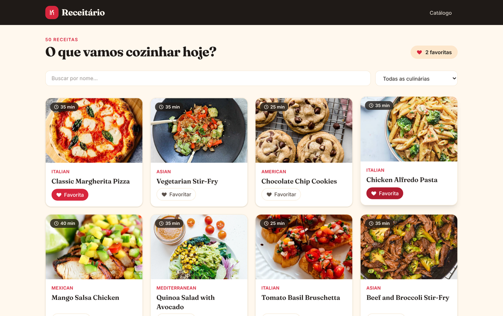

# 🍳 Receitário

Catálogo de receitas em **React + Vite + TypeScript** que consome a API pública
[DummyJSON Recipes](https://dummyjson.com/recipes). Checkpoint 5 — Frontend, FIAP.

## 👤 Integrante

| Nome | RM | Turma |
|---|---|---|
| **Artur Esteves** | **RM569450** | 1TDSPX-2026 |

- GitHub: https://github.com/EstevesArtur
- LinkedIn: https://www.linkedin.com/in/artur-esteves-31bb4130a/

## 🔗 Links

- **Repositório:** https://github.com/EstevesArtur/Receitario
- **Deploy (Vercel):** https://receitario-mauve.vercel.app

## 🖼️ Tela do catálogo



## ✨ Funcionalidades

| Rota | Tela | O que tem |
|---|---|---|
| `/` | Catálogo | Grid de cards (imagem, nome, culinária, tempo total), busca por nome, filtro por culinária e favoritos com contador |
| `/receitas/:id` | Detalhe | Imagem, ingredientes, modo de preparo e tempos; mensagem quando a receita não existe |
| `*` | 404 | Página não encontrada com link de volta ao catálogo |

Regras atendidas:

- Lista de culinárias montada a partir da API (sem valores escritos à mão)
- Busca e filtro funcionam juntos
- Tempo total = `prepTimeMinutes + cookTimeMinutes`, calculado no front
- Favoritos vivem só no estado da página do catálogo
- Quatro estados de tela: carregando (skeleton), erro, vazio e sucesso
- Cleanup no `useEffect` contra respostas atrasadas

## 🛠️ Tecnologias

- React 19 + Vite + TypeScript
- React Router (rotas, rota dinâmica e catch-all)
- Tailwind CSS v4 com tema próprio (@theme) — paleta "cozinha quente" e fontes Fraunces + Inter
- Deploy na Vercel com `vercel.json` (rewrite de SPA)

## ▶️ Como rodar

```bash
git clone https://github.com/EstevesArtur/Receitario.git
cd Receitario
npm install
npm run dev
```

Build de produção: `npm run build` (roda `tsc -b && vite build`).

## 🗂️ Estrutura

```
src/
├── components/   # Header, RecipeCard, RecipeList, RecipeCardSkeleton
├── hooks/        # useRecipes (loading / error / data)
├── layouts/      # MainLayout (header + footer + Outlet)
├── pages/        # CatalogPage, RecipePage, NotFoundPage
├── services/     # chamadas à DummyJSON
└── types/        # Recipe e RecipesResponse
```

## 🌿 Git Flow

`main` ← `release/1.0.0` ← `develop` ← `feature/setup`, `feature/catalogo`, `feature/detalhe`, `feature/deploy`.
Commits no padrão Conventional Commits. Tag `v1.0.0` com Release publicada no GitHub.
